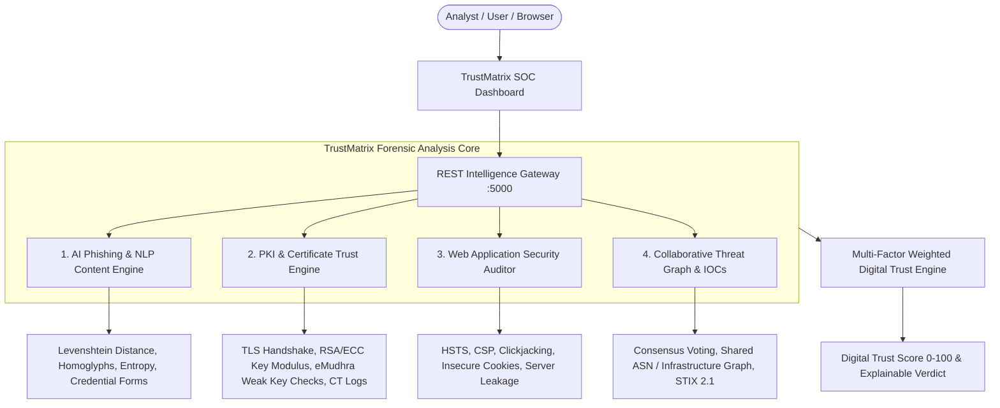

# 🛡️ TrustMatrix AI — AI-Powered Web Threat Detection & Digital Trust Intelligence

[](https://github.com)
[](https://github.com)
[](https://github.com)
[](https://github.com)

**TrustMatrix AI** is a unified, real-time cybersecurity platform designed to protect individuals, enterprises, and institutions from the modern spectrum of web threats. By fusing **AI-driven phishing heuristics**, **deep cryptographic certificate & PKI validation**, **application security posture auditing**, and **collaborative threat intelligence**, TrustMatrix AI delivers an explainable **Digital Trust Index (0–100)** for any target website or digital portal.

---

## 🎯 Problems Solved

1. **Phishing & Brand Impersonation**: Cloned login portals, banking lookalikes, homoglyphs (Punycode / Cyrillic), high-entropy DGA domains, and credential-harvesting forms.
2. **Digital Trust & PKI Degradation (eMudhra Incident Defense)**: Direct detection of weak cryptographic keys (RSA < 2048-bit), duplicate modulus collisions, unverified Certificate Transparency (CT) logs, and rogue Certificate Authority (CA) issuance.
3. **Application-Level Security Weaknesses**: Absence of defensive headers (HSTS, CSP, X-Frame-Options, X-Content-Type-Options), insecure session cookie transport flags (`HttpOnly`, `Secure`, `SameSite`), and server software banner disclosure.
4. **Fraudulent Recruitment & Payment Scams**: Advance-fee employment scams, malicious payment gateway iframes, and fake UPI/SMS smishing redirects.
5. **Collaborative Intelligence Gap**: Community consensus voting, infrastructure threat clustering, and exportable **STIX 2.1 / JSON IOC feeds** for SIEM and SOC ingestion.

---

## 🏗️ System Architecture



### Multi-Factor Trust Score Formula
$$\text{Digital Trust Score} = 0.35 \times S_{\text{AI Phish}} + 0.30 \times S_{\text{PKI Trust}} + 0.20 \times S_{\text{Collab Intel}} + 0.15 \times S_{\text{App Sec}}$$

---

## ⚡ Pre-Configured High-Impact Case Scenarios (1-Click Demo)

The platform comes with 5 pre-loaded, deeply forensic real-world attack scenarios:

| Scenario | Attack Vector | Detection Highlights |
| :--- | :--- | :--- |
| **1. eMudhra Rogue TLS Incident** | Weak Cryptographic Key & CA Subversion | Deficient 1024-bit RSA key, duplicate modulus collision alert, missing public CT log proofs (`UNLOGGED_IN_PUBLIC_CT_LOGS`), flagged eMudhra intermediate. |
| **2. SBI Online Banking Phishing** | Homoglyph & Credential Harvester | Typo-squatting domain (`.xyz`), cloned netbanking layout, SMS OTP & password exfiltration targets, missing HSTS. |
| **3. Tech Recruitment Fraud** | Advance-Fee Employment Scam | Google/Microsoft recruitment impersonation, high-risk job keywords, advance laptop security deposit fee extortion. |
| **4. Razorpay Payment Gateway Spoof** | Payment Interception Skimmer | Rogue checkout iframe on `.top` TLD, hidden WebSocket exfiltration, unencrypted card credentials. |
| **5. GitHub Enterprise Baseline** | Verified Legitimate Platform | Hardened TLS 1.3, DigiCert EV trust chain, public CT log proofs, HSTS preload, strict CSP, **98/100 Trust Score**. |

---

## 🚀 Quickstart Guide

### Prerequisites
- **Node.js**: v18+ (tested on Node v24)
- **npm**: v9+

### 1. Installation
All packages in `server`, `client`, and root are already installed and compiled. If re-installing:
```bash
# In project root
npm run install:all
```

### 2. Start the Full-Stack Application
To start both the Backend Intelligence API (Port 5000) and the React SOC Client (Port 5173):
```bash
npm run dev
```

Alternatively, run them separately:
```bash
# Terminal 1 (Backend Intelligence API)
npm run server

# Terminal 2 (Frontend React SOC Dashboard)
npm run client
```

### 3. Open in Browser
Open **http://localhost:5173** to access the TrustMatrix AI dashboard.

---

## 🔌 API Endpoints Reference

| Method | Endpoint | Description |
| :--- | :--- | :--- |
| `GET` | `/api/health` | Healthcheck and active engines status |
| `GET` | `/api/scenarios` | List 1-click real-world incident scenarios |
| `POST` | `/api/scan` | Perform real-time URL scan or execute incident scenario |
| `GET` | `/api/intel/reports` | Retrieve community threat feed reports |
| `POST` | `/api/intel/reports` | Submit a new suspicious website or IOC |
| `POST` | `/api/intel/vote` | Upvote (flag malicious) or downvote (vouch benign) |
| `GET` | `/api/intel/export/stix`| Export full threat registry as **OASIS STIX 2.1 JSON Bundle** |
| `GET` | `/api/intel/export/iocs` | Export flat Indicators of Compromise feed |

---

## 🔬 Cryptographic Integrity & The eMudhra CA Incident

The eMudhra incident highlighted a critical failure point in modern PKI: **when a Certificate Authority's key generation entropy is compromised, validly signed certificates can have duplicate private keys or easily factored moduli**, enabling man-in-the-middle impersonation without triggering traditional browser red-screen warnings.

**TrustMatrix AI directly solves this** by:
1. Inspecting the raw public key length and mathematical modulus parameters during TLS handshake negotiation.
2. Cross-referencing against known compromised moduli and flagged CA audit advisories.
3. Checking for the presence of Signed Certificate Timestamps (SCTs) verified against public Certificate Transparency monitors (Google Argon, Cloudflare Nimbus).
4. Alerting security teams whenever an anomalous CA issues a certificate for a high-value or protected brand domain.
